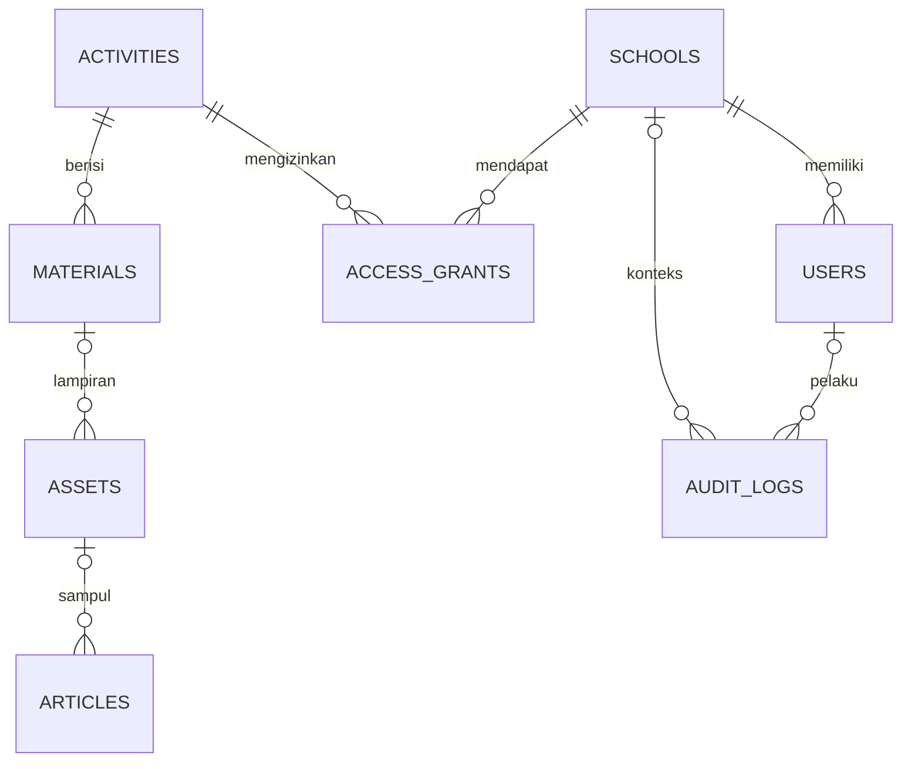

# Skema database

Migrasi di `database/migrations/` adalah sumber skema yang dijalankan langsung pada MySQL/MariaDB produksi. SQLite lokal digunakan untuk pengujian. Untuk instalasi baru jalankan `php artisan migrate --force`.

`database/schema.mysql.sql` adalah ekspor struktur nyata dari instalasi uji MariaDB 11.4.8 setelah migrasi berhasil. Berkas ini hanya referensi skema: tidak mengandung data akun, INSERT, DROP, atau kredensial. Counter AUTO_INCREMENT sementara dan arahan sandbox khusus klien MariaDB dibuang. Gunakan migrasi untuk pemasangan; jangan mengimpor SQL referensi lalu menjalankan migrasi pada skema yang sama. Dump backup produksi diambil dari database milik lembaga dengan prosedur backup, terpisah dari referensi ini.

| Tabel | Kunci dan kolom penting |
|---|---|
| schools | id, name, code unik, is_active |
| users | id, school_id → schools, email unik, password hash, role, is_active, must_change_password |
| activities | id, slug unik, title, theme, year, description, status |
| materials | id, activity_id → activities, slug unik, title, description, type, author_name, status, published_at, video_provider, video_id, video_protection |
| assets | id, material_id opsional → materials, path unik, original_name, mime_type, size, visibility, allow_download |
| access_grants | id, school_id, activity_id, pasangan unik sekolah/kegiatan, expires_at opsional, allow_download, is_active |
| content_pages | id, slug unik, title, summary, body, type, status, verified_at, source_note privat |
| articles | id, kind, slug unik, title, summary, body, status, verified_at, published_at, cover_asset_id opsional → assets |
| settings | id, key unik, value |
| audit_logs | id, user_id/sekolah opsional, action, subject_type/subject_id, ip_hash, created_at |
| sessions | sesi framework; direferensikan pengguna secara logis |
| password_reset_tokens | token pemulihan framework yang disimpan dalam bentuk hash |
| migrations | versi migrasi yang telah diterapkan |
| cache, cache_locks, jobs, job_batches, failed_jobs | tabel infrastruktur framework; konfigurasi aplikasi memakai cache file/antrean sync sehingga tidak memerlukan worker |

Relasi sekolah/pengguna/aktivitas tidak dihapus lewat pengelolaan rutin; penonaktifan dan draf mempertahankan riwayat. Asset dapat dihapus dengan pemeriksaan penggunaan. Grant diperiksa setiap permintaan, termasuk masa berlaku dan izin unduhan. Timestamp mengikuti zona aplikasi Asia/Jakarta pada pengelolaan; tetap pertahankan konfigurasi zona yang konsisten saat migrasi/pemulihan.

Skema tidak mengandung sistem pembayaran, penerimaan siswa lengkap, ujian, atau CBT. Lihat [arsitektur](ARCHITECTURE.md) untuk kebijakan akses dan [backup](BACKUP-RESTORE.md) untuk dump/pemulihan SQL.
